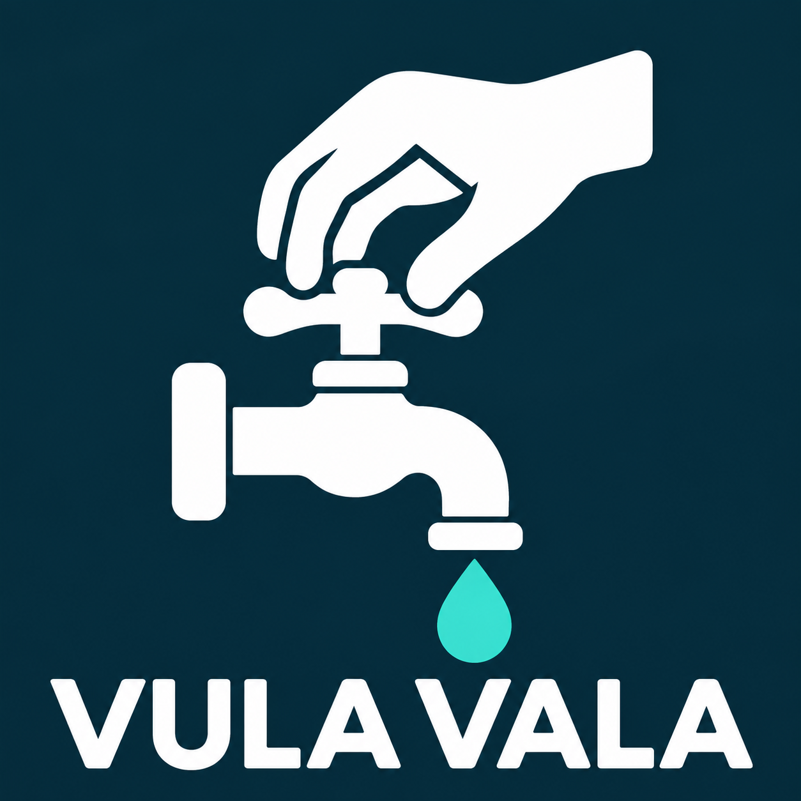

# Vula Vala

Water infrastructure monitoring, analytics and decision support, initially focused on South Africa.

<p align="center">
  
</p>

Vula Vala aims to turn fragmented incident reports into useful infrastructure intelligence: geographic incident views, recurring failure analysis and explainable maintenance priorities. Sensor integration and predictive maintenance are future capabilities that require suitable data and validation.

**Status: project foundation and initial visual identity.** This repository currently contains a brand and image pack with documentation. It does not yet contain a working application, connected sensors, live incident data or predictive models.


*AI-generated concept artwork. This is an imagined network, not an actual infrastructure map or deployment.*

## Explore the first asset pack

- [Visual gallery](docs/asset-gallery.md): six project pictures and five logo variants.
- [Brand guidelines](docs/branding.md): palette, typography direction, usage and limitations.
- [Asset manifest](assets/manifest.json): paths, dimensions, transparency, descriptions and SHA-256 checksums.
- [Generation prompts](docs/image-prompts.json): exact prompts for the delivered images, created using the built-in image generation tool.
- [Initial repository audit and next steps](docs/repository-audit.md).

The logo follows the requested open/close metaphor: a hand above the tap operates its handle, while one droplet leaves the spout. The name remains **Vula Vala**.

## Product direction

The proposed first product combines structured incident collection, geographic search and filtering, asset relationships and baseline reporting. Reports need source information, verification status and uncertainty. Suspected duplicates should be reviewed before merging. Prioritisation should support engineering judgement.

The proposed stack is React and TypeScript, ASP.NET Core, and PostgreSQL with PostGIS in a modular application. These are planning choices, not installed components. Python analytics and MQTT should follow demonstrated requirements.

The next engineering milestone is to validate stakeholder requirements and build a dataset register recording provenance, coverage, available fields, freshness and permitted reuse. No datasets have been acquired or validated in this asset milestone.

## Repository layout

```text
assets/
  branding/       Logo PNGs
  images/         Editorial and conceptual PNGs
  manifest.json  Asset inventory and provenance
docs/
  asset-gallery.md
  branding.md
  image-prompts.json
  repository-audit.md
```

All people, facilities, devices and geographic scenes in this pack are AI-generated illustrations. They must not be presented as actual customers, field evidence, installed hardware or measured operational results. The images are communication assets, not training or evaluation datasets.

## Licence

The repository's existing [MIT licence](LICENSE) is unchanged. The initial public visibility is also unchanged. Image provenance is recorded in the manifest; this pack does not establish trademark clearance or exclusive rights to the generated identity.
