# Vula Vala — visual asset gallery

Six project pictures and five logo variants · 16 November 2026

All artwork was created with the built-in image generation tool. Photographic scenes, hardware and maps are fictional concept illustrations. They are not evidence of deployments, customers, incidents or operational performance.

See [brand guidelines](branding.md), [asset metadata](../assets/manifest.json) and [exact generation prompts](image-prompts.json).

## Logo family

### Primary logo

Stacked brand identity on light surfaces.

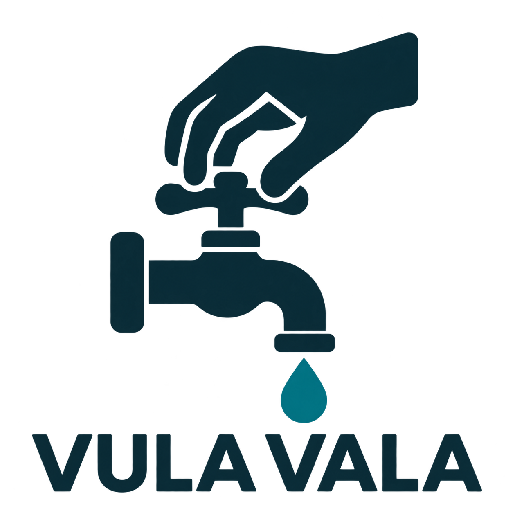

[Download PNG](../assets/branding/logo-primary.png)

### Horizontal logo

Wide headers and mastheads.

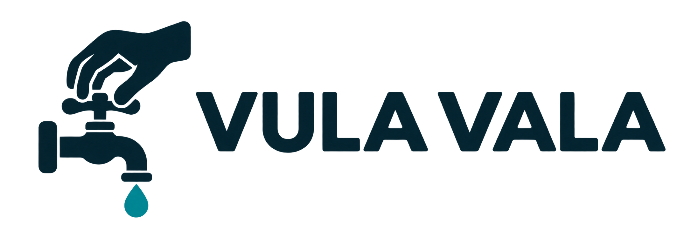

[Download PNG](../assets/branding/logo-horizontal.png)

### Icon-only logo

Larger application branding and avatar concepts.

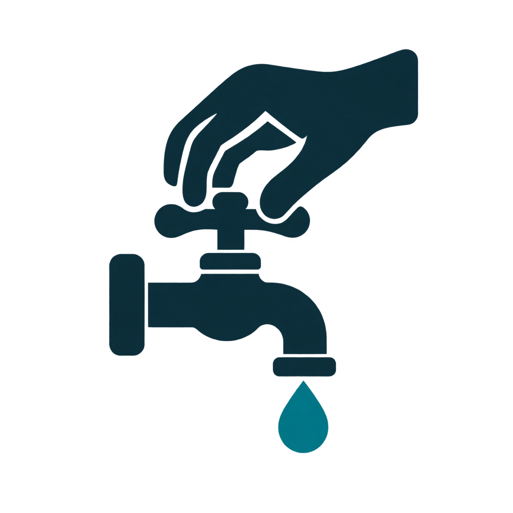

[Download PNG](../assets/branding/logo-icon.png)

### Dark-background logo

Dark presentation panels.

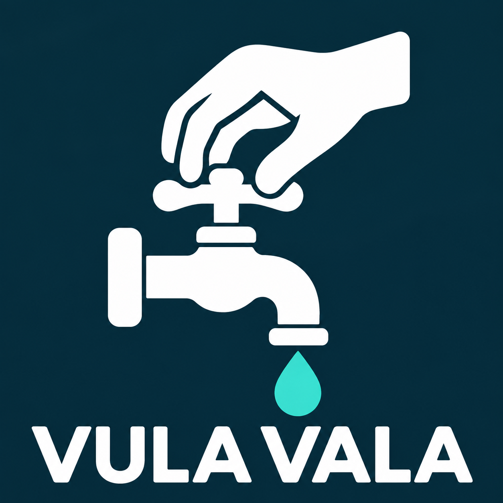

[Download PNG](../assets/branding/logo-dark.png)

### Monochrome logo

Black-on-white document branding.

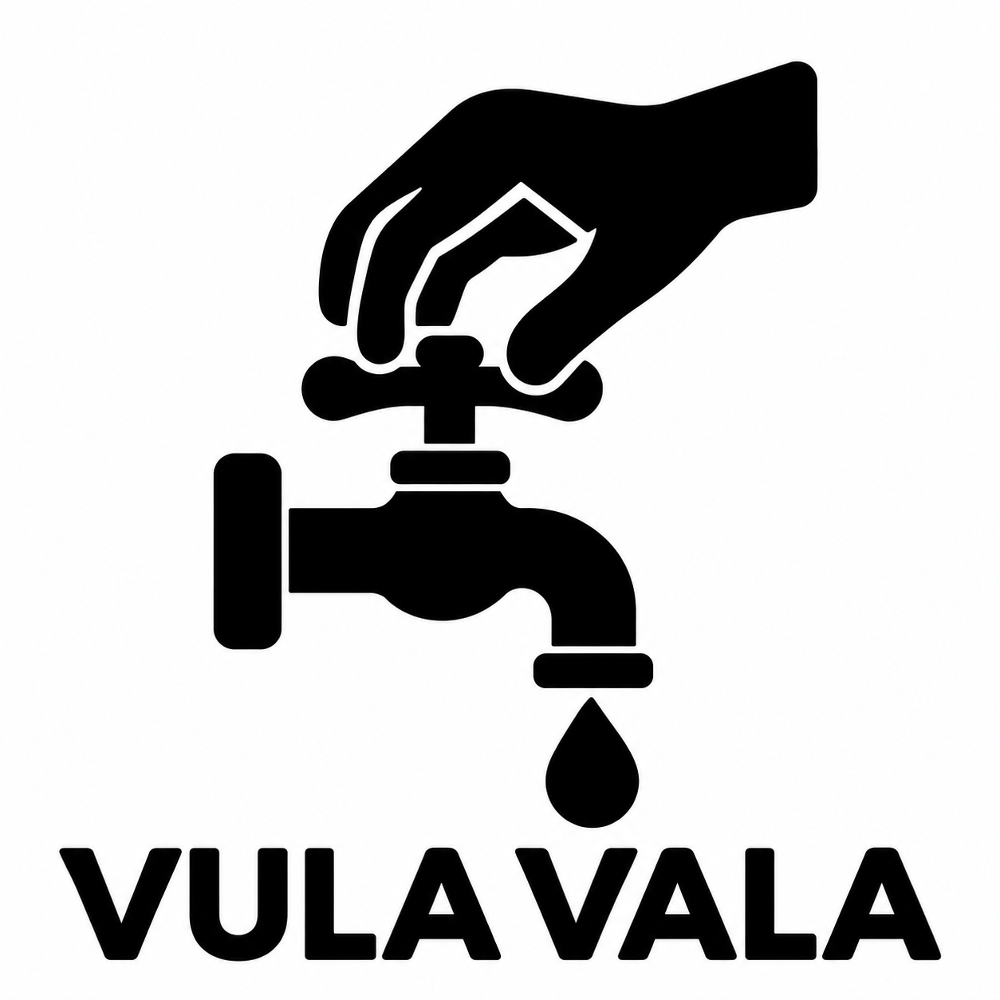

[Download PNG](../assets/branding/logo-monochrome.png)

## Project pictures

### Water network

Hero artwork and vision presentations.

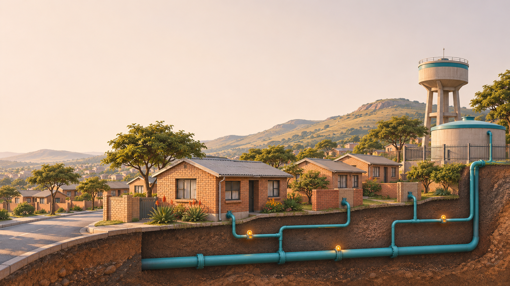

[Download PNG](../assets/images/hero-water-network.png)

### Community reporting

Incident submission introduction.

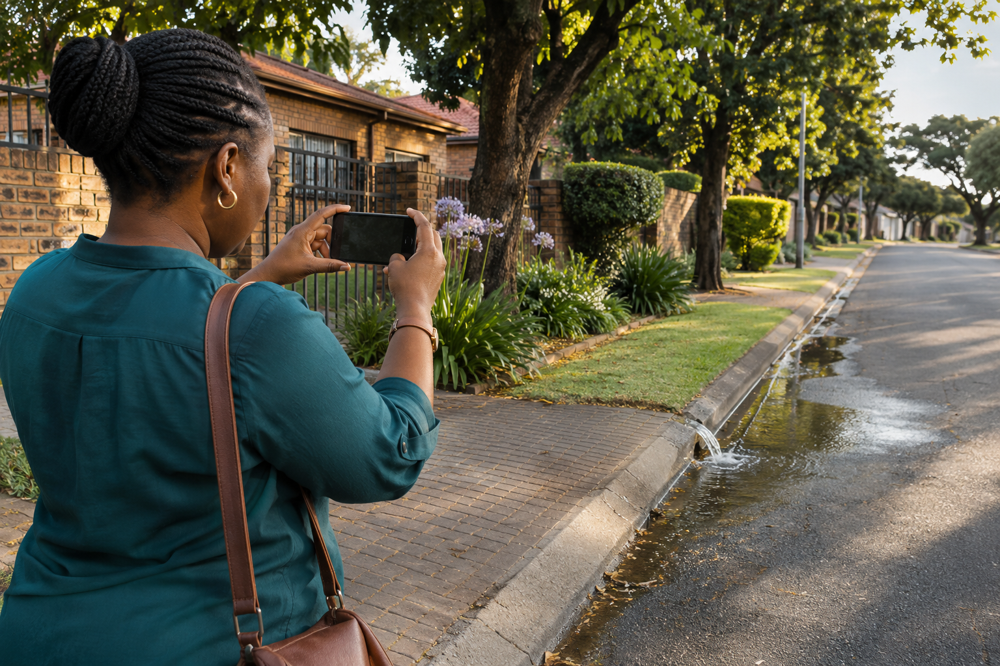

[Download PNG](../assets/images/community-reporting.png)

### Field maintenance

Maintenance workflows and field-team introductions.

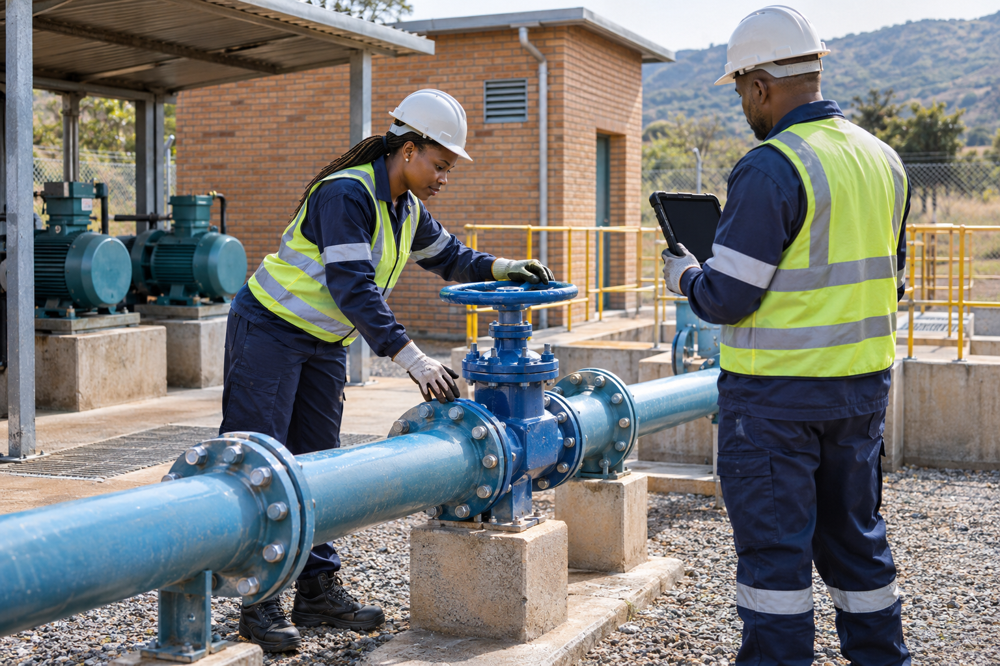

[Download PNG](../assets/images/field-maintenance.png)

### Sensor monitoring

Future sensor integration concept.

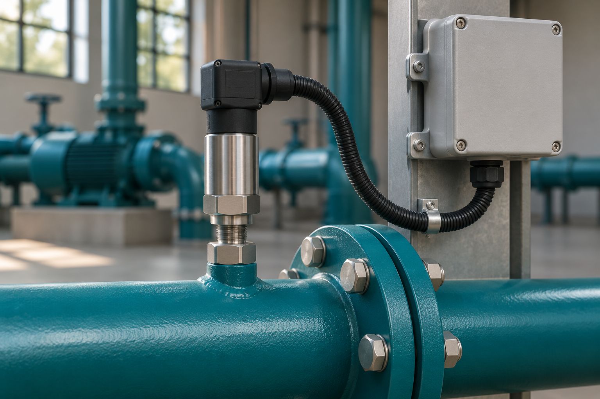

[Download PNG](../assets/images/sensor-monitoring.png)

### Operations planning

Decision support and stakeholder presentations.

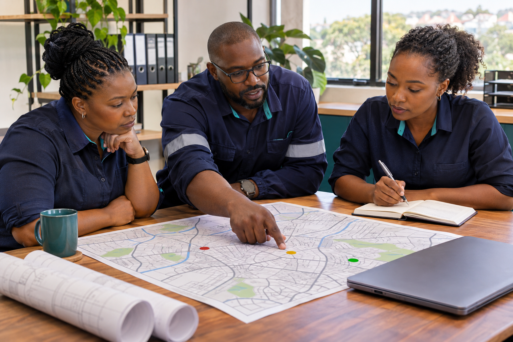

[Download PNG](../assets/images/operations-planning.png)

### Geospatial intelligence

Geographic analysis concept.

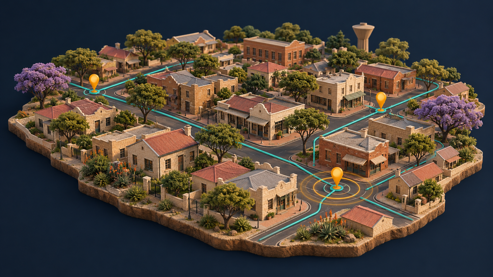

[Download PNG](../assets/images/geospatial-intelligence.png)
